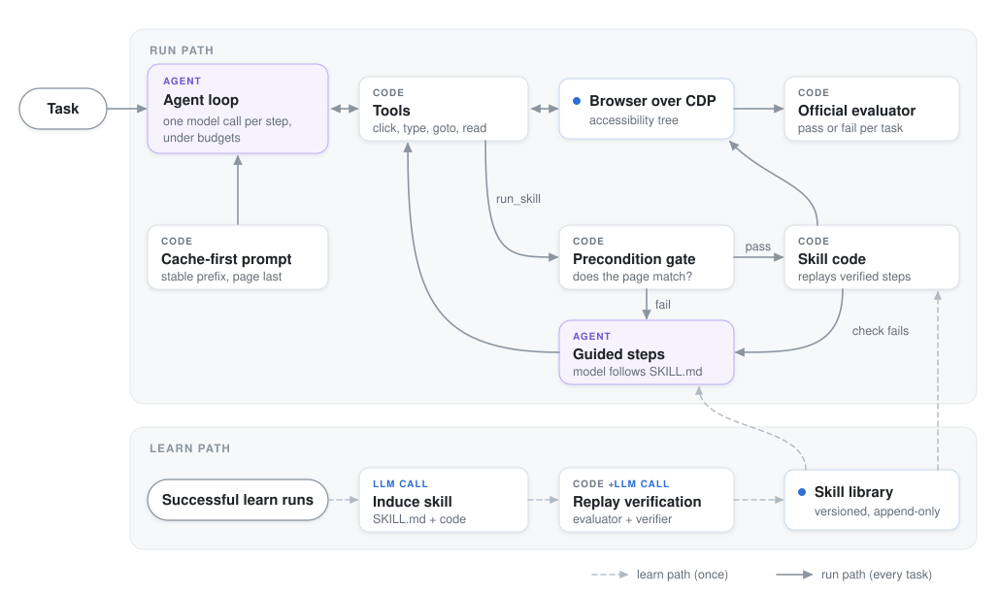

# WebAgent

A browser agent that operates an e-commerce admin console (orders, catalog,
reviews, reports, CMS) from plain-language tasks. It reads the page through the
Chrome DevTools Protocol, acts with tools, and learns a library of verified skills
from its own successful runs.

On 45 held-out [WebArena Verified](https://github.com/ServiceNow/webarena-verified)
tasks it succeeds on **87%** (39/45) with GPT-6 Luna at $0.006 per task. The baseline
harness succeeds on 67%. All experiments in this repository cost 2.41 USD.

## What is new

The browser layer is [browser-harness](https://github.com/browser-use/browser-harness).
The agent runtime is written here, without an agent framework. It adds:

1. **A cache-first context pipeline.** A stable prefix that prompt caching reuses,
   an append-only history of one-line action results, and the current page only at
   the end, as a pruned accessibility tree with on-demand search over cut tables.
   Tokens per task −91%, cost −72%, at equal success.
2. **A verified skill library.** After a successful run, the agent writes a
   `SKILL.md` playbook with optional code.
   - Code is promoted only if it replays correctly on the live site, judged by the
     official evaluator and by a separate verifier.
   - At run time, code executes only when the page passes the skill's preconditions.
     Otherwise the model follows the steps itself.
   - Memory is versioned and append-only.
3. **A reliable runtime.**
   - Step, token, time and dollar budgets.
   - Loop detection and recovery to the last stable page.
   - A per-task environment check, and restart on a lost browser.
   - An append-only event log that every number is recomputed from.
4. **An evaluation harness.**
   - A held-out split and the official evaluator.
   - A state-aware site reset (60 → 24 container rebuilds per run).
   - Paired per-task comparison calibrated against measured run-to-run noise.

## Architecture



## Results

45 held-out test tasks from 15 task templates. Skills are learned only from 15
separate learn tasks.

| Configuration | Success | USD per task | Tasks fixed / broken vs baseline |
|---|---:|---:|---:|
| [Baseline harness](results/2026-11-16_baseline_test_r1/) (3 runs) | 67% (30.3/45) | 0.0029 | — |
| [+ skill library](results/2026-11-16_m2_test_r1/) | 71% (32/45) | 0.0041 | 0 / 1 |
| [+ higher reasoning effort](results/2026-11-16_c_test_r1/) | 82% (37/45) | 0.0040 | 3 / 0 |
| [**+ both (final)**](results/2026-11-16_m2high_test_r1b/) | **87% (39/45)** | 0.0060 | **6 / 0** |

"Fixed" means the baseline failed the task in all 3 runs and the configuration
solved it. "Broken" means the reverse. Full tables, including per-task results,
efficiency and failure classes, are in
[results/memory_arms_report.md](results/memory_arms_report.md).

## What the experiments showed

- **Reasoning effort was the biggest lever.** It lifted success by 15 points at
  almost no extra cost per successful task.
- **Skills added two tasks on top of higher reasoning, within run-to-run noise.**
  On their own they also stayed within noise.
- **Memory has failure modes, and they are measured here:**
  - lessons from failed runs did not help (29 vs 32, within noise);
  - one skill copied a lucky success, a run that was scored correct without setting
    a needed filter, and replayed it with wrong results;
  - on task types never learned from, the memory agent did worse (3/12 vs 8/12).
- **Not every idea ships.** A "check before finishing" step fired 14 times and
  changed 0 answers, so it is off.

## Context and cost

The 15 learn tasks, run once with every page kept in the history and once with the
cache-first layout:

| | Tokens per task | USD per task | Success |
|---|---:|---:|---:|
| [Every page in the history](results/2026-11-16_learn_a/) | 272,506 | 0.0080 | 11/15 |
| [Cache-first layout](results/2026-11-16_learn_c2/) | 23,578 | 0.0022 | 12/15 |

## Engineering notes

| Problem | Fix |
|---|---|
| Truncated tables made the agent report rows as missing | Cut tables by size, state the total, add whole-page search |
| A link opened a new tab and broke every later task | Close new tabs and check the browser before each task |
| The machine ran out of memory and the browser died mid-run | Restart and retry on a lost connection; stop after 3 errors in a row |
| browser-harness keeps 500 CDP events; the evaluator needs full traffic | A separate CDP connection records the HAR |
| Harness changes could invalidate earlier results | Default model requests are pinned byte for byte by a test |

## Run it

```bash
uv sync                      # Python 3.12
cp .env.example .env         # model, key, prices, BUDGET_USD
uv run pytest                # offline tests: no network, API or browser
```

Set up the local WebArena Verified site with
[scripts/setup_webarena.md](scripts/setup_webarena.md). Then build memory and run
the final configuration. The run config uses the committed build
`memory_store/2026-11-16_learn_v4`; set `memory_build` in it to use your own.

```bash
uv run python scripts/build_memory.py --config configs/memory_learn_v3.json --stage induce
uv run python scripts/build_memory.py --config configs/memory_learn_v3.json --stage verify --build memory_store/<date>_learn_v3
uv run python scripts/build_memory.py --config configs/memory_learn_v4.json --stage remerge-facts --build memory_store/<date>_learn_v3
uv run python scripts/run_eval.py --config configs/m2high_test_r1b.json --confirm-paid
uv run python scripts/memory_arms_report.py --arms results/memory_arms.json
```

Paid scripts log every call to [results/spend.md](results/spend.md) and stop at
`BUDGET_USD`.

Full detail: [results/](results/), [DESIGN.md](DESIGN.md) and
[DECISIONS.md](DECISIONS.md) (in Chinese).
